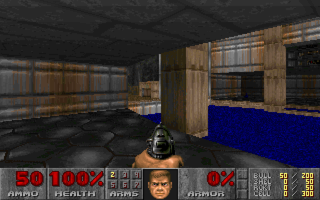

# Pool-room navigation: historical session note

## Scope and provenance

Session `01a179df-e6d8-75f0-856f-6221baf61ee6`, 2026-10-26. Human-described environment: shareware `DOOM1.WAD` / E1M1, attributed by this documentation task. **The archive does not authenticate the IWAD bytes or map identity.** It records 30 healthy completed decisions with matching requested/reported/verified tics and correlated image deliveries, from tic 1 to verified tic 175. Final health: 100; bullets: 50; allowance exhausted. This is historical navigation knowledge, not current game state or authorization.

## Verified route observations

Positions below are approximate Doom units; headings convert native angles to degrees.

- **Start, tic 1:** approximately `(1056, -3616)`, heading 90° toward increasing Y. The view faces a blue pool framed by tan columns and dark paneling.
- **#1–12, through tic 73:** provider-selected advances crossed the pool area toward the far wall. #11/tic 67 showed the far-side floor, a body and barrel; #12 was near `(1056, -3079)`. No exit was visible ahead. Codex revised the objective toward perimeter inspection before #13; the provider then selected its first right turn.
- **#18/tic 109 and #20/tic 121:** nearly the same 2.1° heading, nearby positions and similar wall/barrel views. Codex explicitly recognized the recurrence and focused guidance on assessing a possible gap near a tan column.
- **#22–23/tics 133–139:** views exposed the large tan column, pool and an apparent recess beside lighter tan wall and dark stonework. #24/tic 145 returned to #22’s 319.9° heading and a very similar view. Guidance switched from “right edge” to landmarks as screen directions changed.
- **#25–27/tics 151–163:** verified translation resumed toward the column, reaching approximately `(1160, -3023)`. **Final #30/tic 175:** approximately `(1200, -3056)`, heading 312.9°, with the column dominating the right foreground. The center-ray probe reported a solid line about 22 units ahead, with no recognized manual-door metadata.

## Reference viewpoints

- **Run A, decision #22, post-action tic 133** — session `01a179df-e6d8-75f0-856f-6221baf61ee6`. Player position approximately `(1095.593, -2969.434)` Doom units, converted from native 16.16 coordinates; heading `319.921875°` (0° toward +X; 90° toward +Y).

  **Landmarks:** a large tan column just right of center; blue pool primarily to the right; apparent recess **image-left of the column**, beside the metal-paneled wall end, with lighter tan material and dark stonework behind.

  **Confidence:** pose and image association verified; interpretation of a recess is provisional. **No traversable passage, door, or exit was established.** This is historical evidence, not a current game position, navigation waypoint, instruction to revisit the column or preferred route. A fresh run must choose its own objective from fresh observations.

  **Source:** local Codex A archive listed in [Evidence pointers](#evidence-pointers), 1-based JSONL lines 486–486 (receipt), 492–492 (delivered PNG) and 514–514 (contemporary landmark interpretation). The PNG is historical evidence, not current game state or a waypoint. A new Codex conversation must explicitly open/view the image; reading this Markdown text alone may not display its pixels to the agent.

  

## Unconfirmed hypotheses / unresolved questions

The recess was a candidate side route. Clearance, traversability and destination remained unknown. Screenshots and the qualified probe established no door, usable passage, successful traversal or exit.

## Tactics learned

Choose a high-level objective such as assessing a candidate passage. The **Decisions API chose every low-level action**; this is not a scripted route. Recognize familiar viewpoints using position, heading and image together. A changed view can add information; returning to a similar pose without resolving a question suggests repetition. Prefer landmarks over screen directions. Near geometry, shorten the horizon for earlier observation: this run reduced 6 to 3 tics for its final two decisions after a solid-line probe at about 38 units. That does not establish improved gameplay.

## How to use in a fresh session

Obtain independent current observations and apply these leads only if the environment appears to match. Reset all assumptions about player position, action budget, configuration revision, prompt and live run state. This note neither resumes a browser session nor authorizes a run. One plausible exploration question is whether the apparent recess beside the tan column offers traversable clearance beyond the pool room; confirm it from current evidence.

## Evidence pointers

Archive-relative source under `sessions/`:
`2026/10/26/rollout-2026-10-26T13-21-19-01a179df-e6d8-75f0-856f-6221baf61ee6.jsonl`.
Ranges are exact, inclusive, **1-based JSONL lines**. Screenshot geometry is visual interpretation; passage hypotheses remain inferences.

| Lines | Evidence and interpretation |
| --- | --- |
| 1–1; 28–35 | Observed: session identity, initial telemetry and delivered image. |
| 247–272; 284–314 | Observed: far-side checkpoints/images, perimeter prompt application and first right-turn receipt/image. |
| 395–435; 447–459 | Observed: recurring poses/images and applied prompt revision; gap is explicitly hypothetical. |
| 486–547 | Observed: #22–24 receipts/images and landmark-based prompt application; recess interpretation is provisional. |
| 558–600 | Observed: #25–27 translation receipts and delivered images. |
| 611–676 | Observed: close-column images, qualified probes, horizon edit and final verified receipt/image. |
| 682–686 | Observed: final accounting, 30 reserved/invoked, zero remaining; commentary reports no confirmed exit. |
